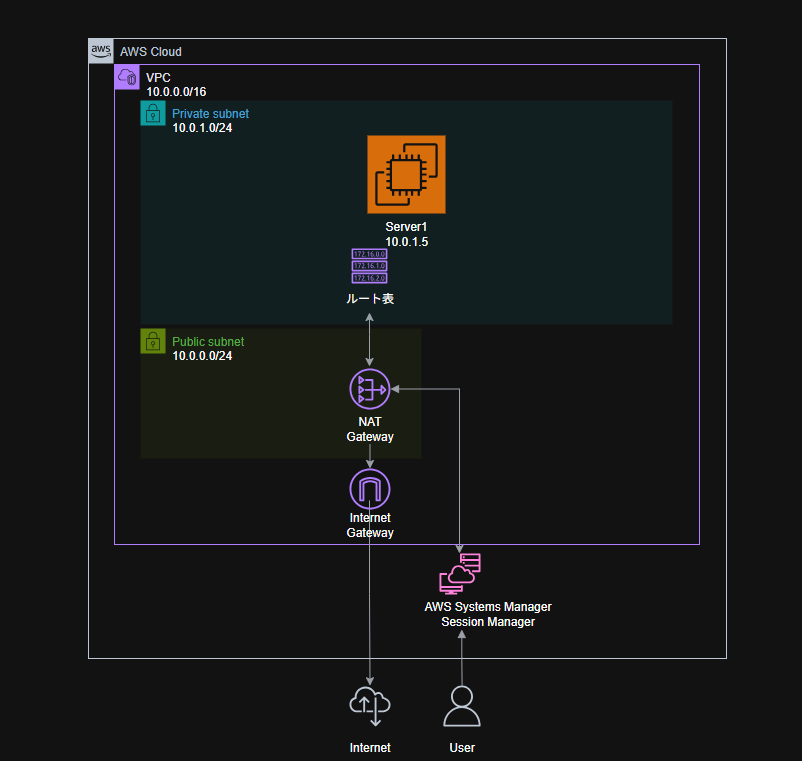

# AWS ネットワーク・仮想マシン構築 (Terraform)

Terraform を使用して、AWS 上に VPC ネットワークおよび RHEL 9 仮想マシン（EC2）を構築するためのコードです。
実務での運用を想定し、パブリック IP を持たないプライベートサブネットへのサーバー配置と、AWS Systems Manager (SSM) Session Manager によるインバウンドポート開放不要な管理接続を採用しています。

---

## 1. 構成図



### 定義しているリソース（計 16 リソース）
* **VPC**: `vpc_IaC` (`10.0.0.0/16`)
* **Subnets**:
  * パブリックサブネット: `subnet-public_IaC` (`10.0.0.0/24` / NAT Gateway 配置用)
  * プライベートサブネット: `subnet-private_IaC` (`10.0.1.0/24` / ワークロード配置用)
* **Internet Gateway & NAT Gateway**:
  * `igw_IaC` / `nat-gw_IaC` / `eip-natgw_IaC`
  * プライベートサブネットからのアウトバウンド通信（パッケージ更新・SSM通信）用
* **Route Tables**:
  * パブリック用ルートテーブル（デフォルトルートを IGW へ）
  * プライベート用ルートテーブル（デフォルトルートを NAT Gateway へ）
* **Security Group**: `server1-sg_IaC`（インバウンド全遮断・アウトバウンドのみ許可）
* **IAM Role / Instance Profile**: `role-ec2-ssm_IaC`（`AmazonSSMManagedInstanceCore` 付与）
* **EC2 Instance**: `Server1` (RHEL 9 / 固定プライベートIP: `10.0.1.5` / `t3.micro`)

---

## 2. 実装のポイント

* **レイヤーごとのファイル分割**: 可読性と保守性を意識し、ネットワーク（`network.tf`）、セキュリティ（`security.tf`）、権限（`iam.tf`）、コンピュート（`compute.tf`）でファイルを分割しています。
* **変数の切り出し (`variables.tf`)**: リージョンやインスタンスタイプ、命名サフィックス、SSH 公開鍵パスなど、環境ごとに変わり得る値は変数化しています。
* **ゼロトラストな管理接続（Session Manager）**: 踏み台サーバーの構築や SSH ポート（TCP/22）の開放を行わず、IAM ロールと NAT Gateway 経由のアウトバウンド通信のみで安全にセッション接続できる構成としています。
* **RHEL 9 への SSM Agent 自動導入**: 標準の RHEL 9 AMI には SSM Agent が含まれていないため、`user_data` を用いて起動時に AWS 公式リポジトリからインストール・有効化を行っています。

---

## 3. 検証手順

### 前提条件
* Terraform `>= 1.1.0`
* AWS CLI（IAM ユーザーまたはロールでの認証設定済み環境）
* SSH 公開鍵 (`~/.ssh/id_rsa_common.pub`) の配置

### 実行コマンド
```bash
terraform init
terraform fmt -check
terraform validate
terraform plan
```

---

## 4. 検証結果（Terraform Plan ログ）

実リソースの課金を抑えるため常時稼働（`apply`）は行わず、`terraform validate` および `terraform plan` にて全 14 リソースの計画がエラーなく生成されることを確認しています。

<details>
<summary>▶ terraform plan の実行ログを表示する（14 to add, 0 to change, 0 to destroy）</summary>

```terraform

data.aws_ami.rhel9: Reading...
data.aws_ami.rhel9: Read complete after 0s [id=ami-05aa2228bc2127ed2]

Terraform used the selected providers to generate the following execution
plan. Resource actions are indicated with the following symbols:
  + create

Terraform will perform the following actions:

  # aws_eip.nat_eip will be created
  + resource "aws_eip" "nat_eip" {
      + allocation_id        = (known after apply)
      + arn                  = (known after apply)
      + association_id       = (known after apply)
      + carrier_ip           = (known after apply)
      + customer_owned_ip    = (known after apply)
      + domain               = "vpc"
      + id                   = (known after apply)
      + instance             = (known after apply)
      + ipam_pool_id         = (known after apply)
      + network_border_group = (known after apply)
      + network_interface    = (known after apply)
      + private_dns          = (known after apply)
      + private_ip           = (known after apply)
      + ptr_record           = (known after apply)
      + public_dns           = (known after apply)
      + public_ip            = (known after apply)
      + public_ipv4_pool     = (known after apply)
      + region               = "ap-northeast-1"
      + tags                 = {
          + "Name" = "eip-natgw_IaC"
        }
      + tags_all             = {
          + "Name" = "eip-natgw_IaC"
        }
    }

  # aws_iam_instance_profile.ssm_profile will be created
  + resource "aws_iam_instance_profile" "ssm_profile" {
      + arn         = (known after apply)
      + create_date = (known after apply)
      + id          = (known after apply)
      + name        = "profile-ec2-ssm_IaC"
      + name_prefix = (known after apply)
      + path        = "/"
      + role        = "role-ec2-ssm_IaC"
      + tags_all    = (known after apply)
      + unique_id   = (known after apply)
    }

  # aws_iam_role.ssm_role will be created
  + resource "aws_iam_role" "ssm_role" {
      + arn                   = (known after apply)
      + assume_role_policy    = jsonencode(
            {
              + Statement = [
                  + {
                      + Action    = "sts:AssumeRole"
                      + Effect    = "Allow"
                      + Principal = {
                          + Service = "ec2.amazonaws.com"
                        }
                    },
                ]
              + Version   = "2012-10-17"
            }
        )
      + create_date           = (known after apply)
      + force_detach_policies = false
      + id                    = (known after apply)
      + managed_policy_arns   = (known after apply)
      + max_session_duration  = 3600
      + name                  = "role-ec2-ssm_IaC"
      + name_prefix           = (known after apply)
      + path                  = "/"
      + tags_all              = (known after apply)
      + unique_id             = (known after apply)

      + inline_policy (known after apply)
    }

  # aws_iam_role_policy_attachment.ssm_policy will be created
  + resource "aws_iam_role_policy_attachment" "ssm_policy" {
      + id         = (known after apply)
      + policy_arn = "arn:aws:iam::aws:policy/AmazonSSMManagedInstanceCore"
      + role       = "role-ec2-ssm_IaC"
    }

  # aws_instance.server1 will be created
  + resource "aws_instance" "server1" {
      + ami                                  = "ami-05aa2228bc2127ed2"
      + arn                                  = (known after apply)
      + associate_public_ip_address          = (known after apply)
      + availability_zone                    = (known after apply)
      + disable_api_stop                     = (known after apply)
      + disable_api_termination              = (known after apply)
      + ebs_optimized                        = (known after apply)
      + enable_primary_ipv6                  = (known after apply)
      + force_destroy                        = false
      + get_password_data                    = false
      + host_id                              = (known after apply)
      + host_resource_group_arn              = (known after apply)
      + iam_instance_profile                 = "profile-ec2-ssm_IaC"
      + id                                   = (known after apply)
      + instance_initiated_shutdown_behavior = (known after apply)
      + instance_lifecycle                   = (known after apply)
      + instance_state                       = (known after apply)
      + instance_type                        = "t3.micro"
      + ipv6_address_count                   = (known after apply)
      + ipv6_addresses                       = (known after apply)
      + key_name                             = "key-common_IaC"
      + monitoring                           = (known after apply)
      + outpost_arn                          = (known after apply)
      + password_data                        = (known after apply)
      + placement_group                      = (known after apply)
      + placement_group_id                   = (known after apply)
      + placement_partition_number           = (known after apply)
      + primary_network_interface_id         = (known after apply)
      + private_dns                          = (known after apply)
      + private_ip                           = "10.0.1.5"
      + public_dns                           = (known after apply)
      + public_ip                            = (known after apply)
      + region                               = "ap-northeast-1"
      + secondary_private_ips                = (known after apply)
      + security_groups                      = (known after apply)
      + source_dest_check                    = true
      + spot_instance_request_id             = (known after apply)
      + subnet_id                            = (known after apply)
      + tags                                 = {
          + "Name" = "Server1"
        }
      + tags_all                             = {
          + "Name" = "Server1"
        }
      + tenancy                              = (known after apply)
      + user_data                            = <<-EOT
            #!/bin/bash
            dnf install -y https://s3.ap-northeast-1.amazonaws.com/amazon-ssm-ap-northeast-1/latest/linux_amd64/amazon-ssm-agent.rpm
            systemctl enable --now amazon-ssm-agent
        EOT
      + user_data_base64                     = (known after apply)
      + user_data_replace_on_change          = false
      + vpc_security_group_ids               = (known after apply)

      + capacity_reservation_specification (known after apply)

      + cpu_options (known after apply)

      + ebs_block_device (known after apply)

      + enclave_options (known after apply)

      + ephemeral_block_device (known after apply)

      + instance_market_options (known after apply)

      + maintenance_options (known after apply)

      + metadata_options (known after apply)

      + network_interface (known after apply)

      + primary_network_interface (known after apply)

      + private_dns_name_options (known after apply)

      + root_block_device (known after apply)

      + secondary_network_interface (known after apply)
    }

  # aws_internet_gateway.igw will be created
  + resource "aws_internet_gateway" "igw" {
      + arn      = (known after apply)
      + id       = (known after apply)
      + owner_id = (known after apply)
      + region   = "ap-northeast-1"
      + tags     = {
          + "Name" = "igw_IaC"
        }
      + tags_all = {
          + "Name" = "igw_IaC"
        }
      + vpc_id   = (known after apply)
    }

  # aws_key_pair.common_key will be created
  + resource "aws_key_pair" "common_key" {
      + arn             = (known after apply)
      + fingerprint     = (known after apply)
      + id              = (known after apply)
      + key_name        = "key-common_IaC"
      + key_name_prefix = (known after apply)
      + key_pair_id     = (known after apply)
      + key_type        = (known after apply)
      + public_key      = "ssh-rsa AAAAB3NzaC1yc2EAAAADAQABAAACAQCsunKVe1uzYNiy6FsdjVkcDrh1b5NTTjbcdweckZWpZ+dyK3TjdynkZPcVG4vwI/cWQe+xNlqRo/HRqZBNBilZa4K2oG5iMecxGj0QianQm+pDWGwUjG5htdOsnw38v5f1mjwMkKo+BrbDAW53hDIym+StvHlUa345QFyXiwoNuvbvTSEpwfBqYHGdyKvXX4/72Om5iV/sTJfYvDBr/Ek0bERixIQoEyVWztJuuguQCqEogyiWuypAvQwxp9mzx5oklWK2GWLC4yoJn/SuMui2kYHI+X8u20dKplnPhqX4qT37jbRAbi8nFhEF+ws5H3HD54DupVURccUERn+WbnOFadXXTou4O3Kb7gMUEo6osB+lZ2PU2KQu1azS5urKjMULF4WRcwq8dUFbWCuOqFdG8LCYPQzK19h2sOl1gUY9zXCsc5AF3qVXLebyHi+WCfOgbysixClgH62DtSvVVa4Z4t3MjGJEm7sL0exNZTks5H5e98lBSgHhW9b0+z16ygWegDUSyQo7eYPyG7QTmSpqqfegRa7aZSB65CKGNojGcUC1H5+m2io4oTfJEZxppe6Jx2CTh0q9Rda/iLKJJIs5c9ASp8s5oDjTQoLP2sjAN2qQ1EFOSd7E8HTlZvBf9a1DdbyB8mR+cd5FSGe7PkE8dEOgApq8i00OBQOViwIs7Q== multicloud"
      + region          = "ap-northeast-1"
      + tags_all        = (known after apply)
    }

  # aws_nat_gateway.nat_gw will be created
  + resource "aws_nat_gateway" "nat_gw" {
      + allocation_id                      = (known after apply)
      + association_id                     = (known after apply)
      + auto_provision_zones               = (known after apply)
      + auto_scaling_ips                   = (known after apply)
      + availability_mode                  = (known after apply)
      + connectivity_type                  = "public"
      + id                                 = (known after apply)
      + network_interface_id               = (known after apply)
      + private_ip                         = (known after apply)
      + public_ip                          = (known after apply)
      + region                             = "ap-northeast-1"
      + regional_nat_gateway_address       = (known after apply)
      + regional_nat_gateway_auto_mode     = (known after apply)
      + route_table_id                     = (known after apply)
      + secondary_allocation_ids           = (known after apply)
      + secondary_private_ip_address_count = (known after apply)
      + secondary_private_ip_addresses     = (known after apply)
      + subnet_id                          = (known after apply)
      + tags                               = {
          + "Name" = "nat-gw_IaC"
        }
      + tags_all                           = {
          + "Name" = "nat-gw_IaC"
        }
      + vpc_id                             = (known after apply)
    }

  # aws_route_table.private_rt will be created
  + resource "aws_route_table" "private_rt" {
      + arn              = (known after apply)
      + id               = (known after apply)
      + owner_id         = (known after apply)
      + propagating_vgws = (known after apply)
      + region           = "ap-northeast-1"
      + route            = [
          + {
              + cidr_block                 = "0.0.0.0/0"
              + nat_gateway_id             = (known after apply)
                # (12 unchanged attributes hidden)
            },
        ]
      + tags             = {
          + "Name" = "rt-private_IaC"
        }
      + tags_all         = {
          + "Name" = "rt-private_IaC"
        }
      + vpc_id           = (known after apply)
    }

  # aws_route_table.public_rt will be created
  + resource "aws_route_table" "public_rt" {
      + arn              = (known after apply)
      + id               = (known after apply)
      + owner_id         = (known after apply)
      + propagating_vgws = (known after apply)
      + region           = "ap-northeast-1"
      + route            = [
          + {
              + cidr_block                 = "0.0.0.0/0"
              + gateway_id                 = (known after apply)
                # (12 unchanged attributes hidden)
            },
        ]
      + tags             = {
          + "Name" = "rt-public_IaC"
        }
      + tags_all         = {
          + "Name" = "rt-public_IaC"
        }
      + vpc_id           = (known after apply)
    }

  # aws_route_table_association.private_assoc will be created
  + resource "aws_route_table_association" "private_assoc" {
      + id             = (known after apply)
      + region         = "ap-northeast-1"
      + route_table_id = (known after apply)
      + subnet_id      = (known after apply)
    }

  # aws_route_table_association.public_assoc will be created
  + resource "aws_route_table_association" "public_assoc" {
      + id             = (known after apply)
      + region         = "ap-northeast-1"
      + route_table_id = (known after apply)
      + subnet_id      = (known after apply)
    }

  # aws_security_group.server1_sg will be created
  + resource "aws_security_group" "server1_sg" {
      + arn                    = (known after apply)
      + description            = "Security group for Server1 (SSM managed, no inbound allowed)"
      + egress                 = [
          + {
              + cidr_blocks      = [
                  + "0.0.0.0/0",
                ]
              + from_port        = 0
              + ipv6_cidr_blocks = []
              + prefix_list_ids  = []
              + protocol         = "-1"
              + security_groups  = []
              + self             = false
              + to_port          = 0
                # (1 unchanged attribute hidden)
            },
        ]
      + id                     = (known after apply)
      + ingress                = (known after apply)
      + name                   = "server1-sg_IaC"
      + name_prefix            = (known after apply)
      + owner_id               = (known after apply)
      + region                 = "ap-northeast-1"
      + revoke_rules_on_delete = false
      + tags                   = {
          + "Name" = "sg-server1_IaC"
        }
      + tags_all               = {
          + "Name" = "sg-server1_IaC"
        }
      + vpc_id                 = (known after apply)
    }

  # aws_subnet.private will be created
  + resource "aws_subnet" "private" {
      + arn                                            = (known after apply)
      + assign_ipv6_address_on_creation                = false
      + availability_zone                              = "ap-northeast-1a"
      + availability_zone_id                           = (known after apply)
      + cidr_block                                     = "10.0.1.0/24"
      + enable_dns64                                   = false
      + enable_resource_name_dns_a_record_on_launch    = false
      + enable_resource_name_dns_aaaa_record_on_launch = false
      + id                                             = (known after apply)
      + ipv6_cidr_block                                = (known after apply)
      + ipv6_cidr_block_association_id                 = (known after apply)
      + ipv6_native                                    = false
      + map_public_ip_on_launch                        = false
      + owner_id                                       = (known after apply)
      + private_dns_hostname_type_on_launch            = (known after apply)
      + region                                         = "ap-northeast-1"
      + tags                                           = {
          + "Name" = "subnet-private_IaC"
        }
      + tags_all                                       = {
          + "Name" = "subnet-private_IaC"
        }
      + vpc_id                                         = (known after apply)
    }

  # aws_subnet.public will be created
  + resource "aws_subnet" "public" {
      + arn                                            = (known after apply)
      + assign_ipv6_address_on_creation                = false
      + availability_zone                              = "ap-northeast-1a"
      + availability_zone_id                           = (known after apply)
      + cidr_block                                     = "10.0.0.0/24"
      + enable_dns64                                   = false
      + enable_resource_name_dns_a_record_on_launch    = false
      + enable_resource_name_dns_aaaa_record_on_launch = false
      + id                                             = (known after apply)
      + ipv6_cidr_block                                = (known after apply)
      + ipv6_cidr_block_association_id                 = (known after apply)
      + ipv6_native                                    = false
      + map_public_ip_on_launch                        = true
      + owner_id                                       = (known after apply)
      + private_dns_hostname_type_on_launch            = (known after apply)
      + region                                         = "ap-northeast-1"
      + tags                                           = {
          + "Name" = "subnet-public_IaC"
        }
      + tags_all                                       = {
          + "Name" = "subnet-public_IaC"
        }
      + vpc_id                                         = (known after apply)
    }

  # aws_vpc.vpc will be created
  + resource "aws_vpc" "vpc" {
      + arn                                  = (known after apply)
      + cidr_block                           = "10.0.0.0/16"
      + default_network_acl_id               = (known after apply)
      + default_route_table_id               = (known after apply)
      + default_security_group_id            = (known after apply)
      + dhcp_options_id                      = (known after apply)
      + enable_dns_hostnames                 = true
      + enable_dns_support                   = true
      + enable_network_address_usage_metrics = (known after apply)
      + id                                   = (known after apply)
      + instance_tenancy                     = "default"
      + ipv6_association_id                  = (known after apply)
      + ipv6_cidr_block                      = (known after apply)
      + ipv6_cidr_block_network_border_group = (known after apply)
      + main_route_table_id                  = (known after apply)
      + owner_id                             = (known after apply)
      + region                               = "ap-northeast-1"
      + tags                                 = {
          + "Name" = "vpc_IaC"
        }
      + tags_all                             = {
          + "Name" = "vpc_IaC"
        }
    }

Plan: 16 to add, 0 to change, 0 to destroy.

─────────────────────────────────────────────────────────────────────────────

Note: You didn't use the -out option to save this plan, so Terraform can't
guarantee to take exactly these actions if you run "terraform apply" now.

```

</details>