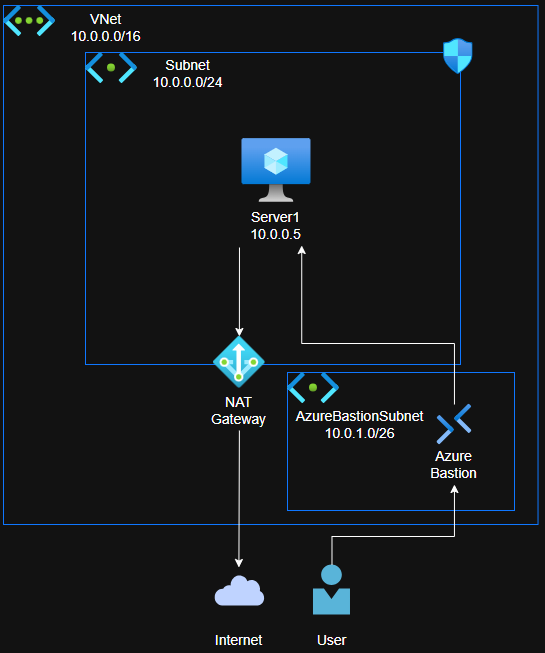

# Azure ネットワーク・仮想マシン構築 (Terraform)

Terraform を使用して、Azure 上に仮想ネットワークおよび RHEL 9 仮想マシンを構築するためのコードです。

---

## 1. 構成図



### 定義しているリソース（計 14 リソース）
* **Resource Group**: `TestGroup_IaC` (`japaneast`)
* **Virtual Network**: `vnet_IaC` (`10.0.0.0/16`)
* **Subnets**:
  * ワークロード用サブネット (`10.0.0.0/24`)
  * Azure Bastion 用サブネット (`AzureBastionSubnet` / `10.0.1.0/26`)
* **Network Security Group (NSG)**: `AzureBastionSubnet` からの SSH (TCP/22) を許可
* **NAT Gateway**: プライベートサブネットからのアウトバウンド通信用
* **Azure Bastion**: ブラウザ経由での管理接続用（Basic SKU）
* **Virtual Machine**: `Server1` (RHEL 9 / 固定プライベートIP: `10.0.0.5` / `Standard_B1s`)

---

## 2. 実装のポイント

* **ファイルの分割**: 可読性を保つため、リソースの種類ごとに `.tf` ファイルを分けています。
* **変数の切り出し (`variables.tf`)**: リージョンや VM サイズ、公開鍵のパスなど、後から変更する可能性のある値は変数化しています。
* **SSH 鍵認証の設定**: パスワードログインは無効化し、`admin_ssh_key` ブロックでローカルの公開鍵を読み込む形にしています。

---

## 3. 検証手順

### 前提条件
* Terraform `>= 1.1.0`
* Azure CLI
* SSH 公開鍵 (`~/.ssh/id_rsa.pub`) の配置

### 実行コマンド
```bash
terraform init
terraform fmt -check
terraform validate
terraform plan
```

---

## 4. 検証結果（Terraform Plan ログ）

実リソースの課金を抑えるため常時稼働（`apply`）は行わず、`terraform validate` および `terraform plan` にて全 14 リソースの計画がエラーなく生成されることを確認しています。

<details>
<summary>▶ terraform plan の実行ログを表示する（14 to add, 0 to change, 0 to destroy）</summary>

```terraform

Terraform used the selected providers to generate the following execution
plan. Resource actions are indicated with the following symbols:
  + create

Terraform will perform the following actions:

  # azurerm_bastion_host.bastion will be created
  + resource "azurerm_bastion_host" "bastion" {
      + copy_paste_enabled     = true
      + dns_name               = (known after apply)
      + file_copy_enabled      = false
      + id                     = (known after apply)
      + ip_connect_enabled     = false
      + location               = "japaneast"
      + name                   = "bastion-main"
      + resource_group_name    = "TestGroup_IaC"
      + scale_units            = 2
      + shareable_link_enabled = false
      + sku                    = "Basic"
      + tunneling_enabled      = false

      + ip_configuration {
          + name                 = "configuration"
          + public_ip_address_id = (known after apply)
          + subnet_id            = (known after apply)
        }
    }

  # azurerm_linux_virtual_machine.server1 will be created
  + resource "azurerm_linux_virtual_machine" "server1" {
      + admin_username                  = "adminuser"
      + allow_extension_operations      = true
      + computer_name                   = (known after apply)
      + disable_password_authentication = true
      + extensions_time_budget          = "PT1H30M"
      + id                              = (known after apply)
      + location                        = "japaneast"
      + max_bid_price                   = -1
      + name                            = "Server1"
      + network_interface_ids           = (known after apply)
      + patch_mode                      = "ImageDefault"
      + platform_fault_domain           = -1
      + priority                        = "Regular"
      + private_ip_address              = (known after apply)
      + private_ip_addresses            = (known after apply)
      + provision_vm_agent              = true
      + public_ip_address               = (known after apply)
      + public_ip_addresses             = (known after apply)
      + resource_group_name             = "TestGroup_IaC"
      + size                            = "Standard_B1s"
      + virtual_machine_id              = (known after apply)

      + admin_ssh_key {
          + public_key = <<-EOT
                ssh-rsa AAAAB3NzaC1yc2EAAAADAQABAAACAQCsunKVe1uzYNiy6FsdjVkcDrh1b5NTTjbcdweckZWpZ+dyK3TjdynkZPcVG4vwI/cWQe+xNlqRo/HRqZBNBilZa4K2oG5iMecxGj0QianQm+pDWGwUjG5htdOsnw38v5f1mjwMkKo+BrbDAW53hDIym+StvHlUa345QFyXiwoNuvbvTSEpwfBqYHGdyKvXX4/72Om5iV/sTJfYvDBr/Ek0bERixIQoEyVWztJuuguQCqEogyiWuypAvQwxp9mzx5oklWK2GWLC4yoJn/SuMui2kYHI+X8u20dKplnPhqX4qT37jbRAbi8nFhEF+ws5H3HD54DupVURccUERn+WbnOFadXXTou4O3Kb7gMUEo6osB+lZ2PU2KQu1azS5urKjMULF4WRcwq8dUFbWCuOqFdG8LCYPQzK19h2sOl1gUY9zXCsc5AF3qVXLebyHi+WCfOgbysixClgH62DtSvVVa4Z4t3MjGJEm7sL0exNZTks5H5e98lBSgHhW9b0+z16ygWegDUSyQo7eYPyG7QTmSpqqfegRa7aZSB65CKGNojGcUC1H5+m2io4oTfJEZxppe6Jx2CTh0q9Rda/iLKJJIs5c9ASp8s5oDjTQoLP2sjAN2qQ1EFOSd7E8HTlZvBf9a1DdbyB8mR+cd5FSGe7PkE8dEOgApq8i00OBQOViwIs7Q== multicloud
            EOT
          + username   = "adminuser"
        }

      + os_disk {
          + caching                   = "ReadWrite"
          + disk_size_gb              = (known after apply)
          + name                      = (known after apply)
          + storage_account_type      = "Standard_LRS"
          + write_accelerator_enabled = false
        }

      + source_image_reference {
          + offer     = "RHEL"
          + publisher = "RedHat"
          + sku       = "9-lvm-gen2"
          + version   = "latest"
        }

      + termination_notification (known after apply)
    }

  # azurerm_nat_gateway.nat_gw will be created
  + resource "azurerm_nat_gateway" "nat_gw" {
      + id                      = (known after apply)
      + idle_timeout_in_minutes = 4
      + location                = "japaneast"
      + name                    = "nat-gw"
      + resource_group_name     = "TestGroup_IaC"
      + resource_guid           = (known after apply)
      + sku_name                = "Standard"
    }

  # azurerm_nat_gateway_public_ip_association.nat_pip_assoc will be created
  + resource "azurerm_nat_gateway_public_ip_association" "nat_pip_assoc" {
      + id                   = (known after apply)
      + nat_gateway_id       = (known after apply)
      + public_ip_address_id = (known after apply)
    }

  # azurerm_network_interface.server1_nic will be created
  + resource "azurerm_network_interface" "server1_nic" {
      + applied_dns_servers           = (known after apply)
      + dns_servers                   = (known after apply)
      + enable_accelerated_networking = false
      + enable_ip_forwarding          = false
      + id                            = (known after apply)
      + internal_dns_name_label       = (known after apply)
      + internal_domain_name_suffix   = (known after apply)
      + location                      = "japaneast"
      + mac_address                   = (known after apply)
      + name                          = "nic-server1"
      + private_ip_address            = (known after apply)
      + private_ip_addresses          = (known after apply)
      + resource_group_name           = "TestGroup_IaC"
      + virtual_machine_id            = (known after apply)

      + ip_configuration {
          + gateway_load_balancer_frontend_ip_configuration_id = (known after apply)
          + name                                               = "internal"
          + primary                                            = (known after apply)
          + private_ip_address                                 = "10.0.0.5"
          + private_ip_address_allocation                      = "Static"
          + private_ip_address_version                         = "IPv4"
          + subnet_id                                          = (known after apply)
        }
    }

  # azurerm_network_security_group.nsg will be created
  + resource "azurerm_network_security_group" "nsg" {
      + id                  = (known after apply)
      + location            = "japaneast"
      + name                = "nsg_IaC"
      + resource_group_name = "TestGroup_IaC"
      + security_rule       = [
          + {
              + access                                     = "Allow"
              + destination_address_prefix                 = "*"
              + destination_address_prefixes               = []
              + destination_application_security_group_ids = []
              + destination_port_range                     = "22"
              + destination_port_ranges                    = []
              + direction                                  = "Inbound"
              + name                                       = "Allow-Bastion-SSH"
              + priority                                   = 1000
              + protocol                                   = "Tcp"
              + source_address_prefix                      = "10.0.1.0/26"
              + source_address_prefixes                    = []
              + source_application_security_group_ids      = []
              + source_port_range                          = "*"
              + source_port_ranges                         = []
                # (1 unchanged attribute hidden)
            },
        ]
    }

  # azurerm_public_ip.bastion_pip will be created
  + resource "azurerm_public_ip" "bastion_pip" {
      + allocation_method       = "Static"
      + fqdn                    = (known after apply)
      + id                      = (known after apply)
      + idle_timeout_in_minutes = 4
      + ip_address              = (known after apply)
      + ip_version              = "IPv4"
      + location                = "japaneast"
      + name                    = "pip-bastion"
      + resource_group_name     = "TestGroup_IaC"
      + sku                     = "Standard"
      + sku_tier                = "Regional"
    }

  # azurerm_public_ip.nat_pip will be created
  + resource "azurerm_public_ip" "nat_pip" {
      + allocation_method       = "Static"
      + fqdn                    = (known after apply)
      + id                      = (known after apply)
      + idle_timeout_in_minutes = 4
      + ip_address              = (known after apply)
      + ip_version              = "IPv4"
      + location                = "japaneast"
      + name                    = "pip-natgw"
      + resource_group_name     = "TestGroup_IaC"
      + sku                     = "Standard"
      + sku_tier                = "Regional"
    }

  # azurerm_resource_group.rg will be created
  + resource "azurerm_resource_group" "rg" {
      + id       = (known after apply)
      + location = "japaneast"
      + name     = "TestGroup_IaC"
    }

  # azurerm_subnet.bastion_subnet will be created
  + resource "azurerm_subnet" "bastion_subnet" {
      + address_prefixes                               = [
          + "10.0.1.0/26",
        ]
      + enforce_private_link_endpoint_network_policies = false
      + enforce_private_link_service_network_policies  = false
      + id                                             = (known after apply)
      + name                                           = "AzureBastionSubnet"
      + resource_group_name                            = "TestGroup_IaC"
      + virtual_network_name                           = "vnet_IaC"
    }

  # azurerm_subnet.subnet will be created
  + resource "azurerm_subnet" "subnet" {
      + address_prefixes                               = [
          + "10.0.0.0/24",
        ]
      + enforce_private_link_endpoint_network_policies = false
      + enforce_private_link_service_network_policies  = false
      + id                                             = (known after apply)
      + name                                           = "subnet_IaC"
      + resource_group_name                            = "TestGroup_IaC"
      + virtual_network_name                           = "vnet_IaC"
    }

  # azurerm_subnet_nat_gateway_association.nat_subnet_assoc will be created
  + resource "azurerm_subnet_nat_gateway_association" "nat_subnet_assoc" {
      + id             = (known after apply)
      + nat_gateway_id = (known after apply)
      + subnet_id      = (known after apply)
    }

  # azurerm_subnet_network_security_group_association.nsg_assoc will be created
  + resource "azurerm_subnet_network_security_group_association" "nsg_assoc" {
      + id                        = (known after apply)
      + network_security_group_id = (known after apply)
      + subnet_id                 = (known after apply)
    }

  # azurerm_virtual_network.vnet will be created
  + resource "azurerm_virtual_network" "vnet" {
      + address_space       = [
          + "10.0.0.0/16",
        ]
      + dns_servers         = (known after apply)
      + guid                = (known after apply)
      + id                  = (known after apply)
      + location            = "japaneast"
      + name                = "vnet_IaC"
      + resource_group_name = "TestGroup_IaC"
      + subnet              = (known after apply)
    }

Plan: 14 to add, 0 to change, 0 to destroy.

─────────────────────────────────────────────────────────────────────────────

Note: You didn't use the -out option to save this plan, so Terraform can't
guarantee to take exactly these actions if you run "terraform apply" now.

```

</details>